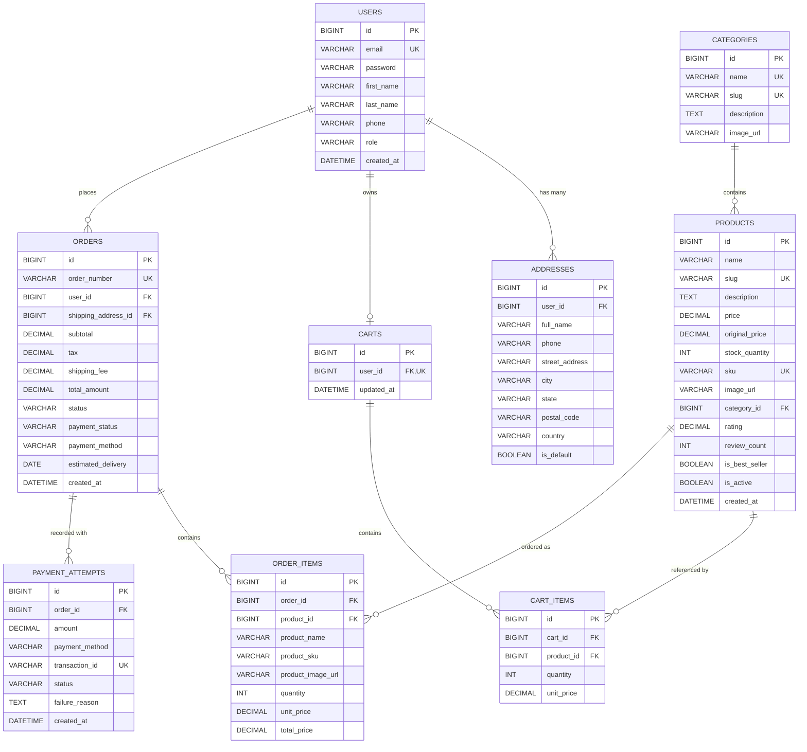

# NexStore — Multi-Tier Enterprise E-Commerce Platform

A production-grade, multi-page, high-converting commercial e-commerce web platform engineered with **React 18, TypeScript, Vite, Node.js, Express, MySQL 8.0, and JWT**.

---

## 1. System Architecture

The application adopts a robust, multi-tier enterprise architecture designed for high throughput, data integrity, and sub-second response times:

```
┌────────────────────────────────────────────────────────────┐
│                  Client Layer (Frontend)                   │
│         React 18 + TypeScript + Vite + Context API         │
│          Amazon & Flipkart Grade UI / UX Standards         │
└─────────────────────────────┬──────────────────────────────┘
                              │ HTTPS / REST (JSON) + Bearer JWT
┌─────────────────────────────▼──────────────────────────────┐
│              Application Layer (REST API Server)           │
│                    Spring Boot 3.3.5                       │
│                                                            │
│  Controllers ──► Security (JWT) ──► Services ──► Repos     │
│  (REST Endpoints)  (Stateless HMAC)  (@Transactional) (JPA)│
└─────────────────────────────┬──────────────────────────────┘
                              │ JDBC / Connection Pool
┌─────────────────────────────▼──────────────────────────────┐
│                  Data Tier (Database)                      │
│                    MySQL 8.0 Server                        │
│          Indexed Schemas, Foreign Keys, ACID Rules         │
└────────────────────────────────────────────────────────────┘
```

### Architectural Principles:
1. **Authoritative Server Pricing**:
   All financial values (line totals, 5% GST taxes, shipping thresholds, grand totals) are derived on the Spring Boot backend directly from database records. Client-side price payloads are strictly ignored.
2. **ACID Transactional Fulfillment**:
   Order placement executes inside `@Transactional` database boundaries. Inventory decrements occur atomically, eliminating race conditions and overselling.
3. **Stateless Security**:
   Spring Security 6 utilizes stateless sessions backed by cryptographically signed HMAC-SHA256 JWT tokens.

---

## 2. Database Design (Entity Relationship Diagram)



---

## 3. Complete REST API Specifications

Base URL: `http://localhost:8080/api`

| Endpoint | Method | Authorization | Description |
| :--- | :--- | :--- | :--- |
| `/api/auth/register` | `POST` | Public | Register new customer account |
| `/api/auth/login` | `POST` | Public | Authenticate credentials and return JWT |
| `/api/auth/me` | `GET` | Authenticated | Retrieve authenticated user profile |
| `/api/auth/profile` | `PUT` | Authenticated | Update user name, phone number |
| `/api/products` | `GET` | Public | Paginated product catalogue with filters & sorting |
| `/api/products/{id}` | `GET` | Public | Get product details by ID |
| `/api/products/search` | `GET` | Public | Full-text keyword search across inventory |
| `/api/categories` | `GET` | Public | Retrieve department categories |
| `/api/cart` | `GET` | Authenticated | Retrieve active shopping cart with verified totals |
| `/api/cart/items` | `POST` | Authenticated | Add item to cart with stock validation |
| `/api/cart/items/{id}` | `PUT` | Authenticated | Adjust item quantity in cart |
| `/api/cart/items/{id}` | `DELETE` | Authenticated | Remove line item from cart |
| `/api/addresses` | `GET` | Authenticated | List saved shipping addresses |
| `/api/addresses` | `POST` | Authenticated | Add a new shipping destination address |
| `/api/addresses/{id}` | `DELETE` | Authenticated | Delete a saved address |
| `/api/orders` | `POST` | Authenticated | Create order with transactional stock decrement |
| `/api/orders` | `GET` | Authenticated | Paginated order history for current customer |
| `/api/orders/{orderNum}` | `GET` | Authenticated | Track order details & shipment timeline |
| `/api/payments/simulate` | `POST` | Authenticated | Digital payment gateway verification |
| `/api/admin/stats` | `GET` | Admin | Real-time sales, order volume, and stock metrics |
| `/api/admin/products` | `POST` | Admin | Add new merchandise to inventory |
| `/api/admin/products/{id}` | `PUT` | Admin | Update pricing, discounts, and inventory |
| `/api/admin/products/{id}` | `DELETE` | Admin | Deactivate product from storefront |
| `/api/admin/categories` | `POST` | Admin | Create department category |
| `/api/admin/categories/{id}` | `PUT` | Admin | Modify category metadata |
| `/api/admin/categories/{id}` | `DELETE` | Admin | Delete category |
| `/api/admin/orders` | `GET` | Admin | Fulfillment console: list all platform orders |
| `/api/admin/orders/{id}/status` | `PUT` | Admin | Advance order tracking: CONFIRMED ➔ PROCESSING ➔ SHIPPED ➔ DELIVERED |

---

## 4. Setup and Run Guide

### 1. Database Initialization (MySQL)
Make sure MySQL 8.0 is running, then execute:
```sql
CREATE DATABASE IF NOT EXISTS ecommerce_db;
```
*(The backend will auto-initialize schema and verified products upon boot!)*

### 2. Launch Node.js Express REST API
```powershell
cd D:\codings\E-Commerce\ecommerce-backend
npm install
npm run dev
```
Backend will be live on `http://localhost:8080/api`.

### 3. Launch React Commercial Frontend
```powershell
cd D:\codings\E-Commerce\ecommerce-frontend
npm install
npm run dev
```
Open your browser at `http://localhost:5173`.
